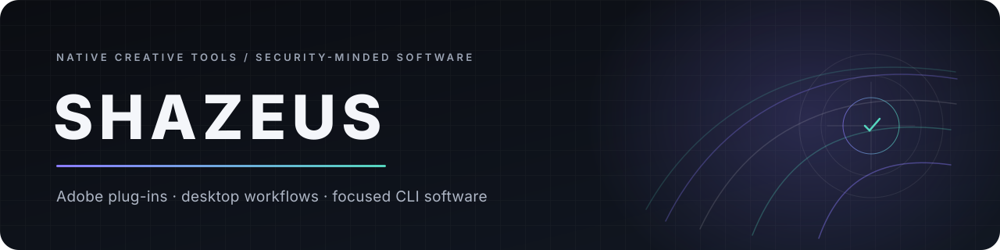

  

  <a href="https://shazeus.github.io">Portfolio</a>
  &nbsp;·&nbsp;
  <a href="https://github.com/shazeus?tab=repositories">Repositories</a>
  &nbsp;·&nbsp;
  <a href="https://guns.lol/shazeus">Links</a>

## Software for editors, developers, and the space between

I'm Shazeus. I build native Adobe plug-ins, desktop media utilities, and focused command-line tools. The subjects change, but the goal usually does not: take a real workflow, remove unnecessary steps, and ship something people can run locally.

Right now, most of my work sits in three areas:

- **Creative tooling** — native effects and utilities for After Effects, Premiere Pro, and media workflows.
- **Applied inference** — bringing computer-vision models into practical desktop software with explicit performance and failure behaviour.
- **Developer and security tools** — small Python CLIs for auditing, reconnaissance, automation, and day-to-day operations.

## Featured engineering

### [DepthVision](https://github.com/shazeus/DepthVision) — monocular depth, inside Adobe

`C++` · `Adobe SDK` · `ONNX Runtime` · `DirectML` · `CMake`

A native After Effects and Premiere Pro effect that turns an ordinary frame into relative depth without sending footage to a remote service. It packages Depth Anything V2 with GPU/CPU execution, robust range normalization, edge-aware refinement, temporal stabilization, and eight compositing outputs. The Windows beta includes a reproducible installer, checksums, tests, and a documented runtime layout.

<a href="https://github.com/shazeus/DepthVision/releases">Download</a> · <a href="https://github.com/shazeus/DepthVision#processing-pipeline">Processing pipeline</a> · <a href="https://github.com/shazeus/DepthVision/blob/main/docs/ARCHITECTURE.md">Architecture</a>

### [Linear](https://github.com/shazeus/linear) — technical overlays from image regions

`C++17` · `Adobe SDK` · `Computer Vision` · `CMake`

An open-source native Adobe effect that detects color- or motion-derived regions and renders tracked boxes, markers, networks, measurement grids, paths, labels, and region-confined fills. Its shared core is render-order independent, covered by 43 dependency-free tests, and built on Windows and Linux in CI.

<a href="https://github.com/shazeus/linear/releases">Releases</a> · <a href="https://github.com/shazeus/linear/blob/main/docs/ARCHITECTURE.md">Architecture</a> · <a href="https://github.com/shazeus/linear/blob/main/docs/USER_GUIDE.md">User guide</a>

## More projects

| Project | What it is | Main stack |
| --- | --- | --- |
| **[LambDownload](https://github.com/shazeus/LambDownload)** | A desktop media downloader with editor-safe output and drag-and-drop into creative applications. | TypeScript, React, Electron, Python, FFmpeg |
| **[Shellguard](https://github.com/shazeus/shellguard)** | A terminal session recorder that audits command streams for exposed secrets and risky shell patterns. | Python, PTY, JSONL |
| **[GhSpy](https://github.com/shazeus/ghspy)** | A GitHub OSINT CLI for public profile, activity, technology, identity, and collaboration analysis. | Python, GitHub API |
| **[dotfiles-tool](https://github.com/shazeus/dotfiles-tool)** | A profile-aware dotfile manager for tracking, encrypting, syncing, and restoring configuration. | Python, Git |

## Working stack

| Area | Tools I use in public projects |
| --- | --- |
| Native and media | `C++` `CMake` `Adobe SDK` `ONNX Runtime` `DirectML` `FFmpeg` |
| Desktop and web | `TypeScript` `React` `Electron` `Node.js` |
| CLI and automation | `Python` `PowerShell` `GitHub API` `Docker` `Kubernetes` |
| Build and delivery | `GitHub Actions` `Inno Setup` `packaged runtimes` `release checksums` |

## How I like to build

I prefer projects that end in an installable tool, not only a source tree. That means treating packaging, failure messages, documentation, validation, and known limits as part of the product. I also keep inference and media processing local when the workflow allows it.

Several projects are still beta or experimental. Their READMEs say what has actually been validated and what still needs host or platform testing; I would rather make the boundary visible than hide it behind a version number.

---

  The best place for a project question is its issue tracker. 
  For everything else: <a href="https://shazeus.github.io">shazeus.github.io</a>

